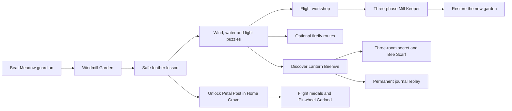

# Mosslight: Windmill Garden

**Astra design package, implemented by Terra in this branch.** See the [implementation and verification guide](../WINDMILL_GARDEN.md). This document records the expansion contracts and original pacing hypotheses. Automated routes now exercise the implementation; physical-device feel and first-time playtime targets remain to be evaluated. TestFlight status is verified separately.

The expansion gives Pip a new way to travel, then builds a complete adventure around learning it: powered flight and glide, reversible garden machinery, branching routes, a discoverable beehive, a guardian that tests different skills, and a replayable flight activity at home.

## First release

| Addition                         | What the player gets                                                                                                                                                        |
| -------------------------------- | --------------------------------------------------------------------------------------------------------------------------------------------------------------------------- |
| **Wind Feather**                 | Jump, release, then hold Jump again to rise. Release to glide; land to refill. No extra action button. Growth and flight are independent.                                   |
| **Windmill Garden**              | A fourth world with twelve exploration rooms and a guardian arena, three optional firefly routes, eight checkpoints and free feather replacement at retry points.           |
| **Garden machinery**             | Wind direction, a mill brake, water level and light routing change visible parts of the route. Clues show how they connect; solving a main gate keeps it open for that run. |
| **Lantern Beehive**              | A real three-room secret level. Read the pollen clue to reveal it, solve its flower puzzle and earn a Bee Scarf outfit. Discovery unlocks permanent journal replay.         |
| **Bramblewing, the Mill Keeper** | Three phases, six hits: clear a low sweep; fly to a high vane; then land beneath an overhead sweep, jump a low sweep and reach the vane again.                              |
| **Petal Post**                   | A separate Home Grove course with sixteen flower hoops, landing bonuses and medals. Target playtime 30–50 seconds, hard limit 60 seconds; immediate free retry.             |
| **Journal and grove progress**   | Track the new world's three fireflies, saved secret discovery and activity records. Earn a Bee Scarf and Pinwheel Garland; the grove gains three more residents.            |
| **Reliable integration**         | Preserve old saves, modes, coins and cosmetics. Handle portals, retries, pause and rewards consistently. Ship only after integrated gameplay and native release checks.     |

The world opens after beating the Meadow guardian in any garden mode. Finding the first feather immediately unlocks Petal Post; beating the new guardian is not required to practice flight. Existing worlds and challenges retain their availability and records.

## Player journey

The main route teaches a mechanic safely before combining it with another. Broad floors catch the early flight mistakes. Upper and lower branches rejoin, and solved gates stay open so changing a mechanism for a secret cannot trap Pip. More time comes from exploration and puzzle decisions rather than repeating the same jump corridor.

Initial pacing goals are 6–9 minutes to reach the guardian on a first direct exploration, or 8–12 minutes with all firefly branches. The beehive adds a separate 2–4-minute detour. These are goals for human playtests, not timings inferred from level width. A practiced direct route should be much faster.

## Rules carried forward

- Falling into a gap still loses a life, including during star power.
- A hit shrinks Big Pip; a hit while Small loses a life. Shrinking keeps the feather; losing a life drops it, with a free replacement before mandatory flight.
- Fifty coins award a life, up to three. Scene changes and retries cannot duplicate coin awards.
- Diamonds grow Pip; descending onto a bug squashes it; stars retain their ten-second protection and contact attack.
- Classic and Timed retain three-life runs. Relaxed retains checkpoint retries and gains phase checkpoints for this new guardian only.
- Cosmetic rewards never change movement, damage or puzzle access.

Initial flight tuning is 1.20 seconds of cumulative powered lift, a −170 px/s upward target, a +180 px/s glide descent cap and 0.20 seconds of stable ground contact to refill. These values must be tuned together with the routes, guardian and minigame. A long glide can cross much farther than a comfortable powered segment, so important puzzle boundaries use visible solid gates rather than gap distance alone.

## Art, sound and interaction

Continue the clean, colorful cartoon direction: warm wood and yellow sails, rounded flowers, readable blue water and a golden honeycomb secret. Flight gets distinct rising and gliding poses. Mechanical settings have arrows, outlines and symbols as well as color. Warnings remain understandable with sound and haptics off.

Reuse the local canvas artwork and synthesized audio. Add only the necessary feather, machinery, hive, guardian, hoop and cosmetic primitives. The existing left/right/jump controls remain the gameplay controls. Portals use a deliberate stationary jump prompt; running jumps keep their normal meaning. Check phone safe areas and adjustable controls before fixing the final HUD and target placement.

## Implementation documents

| Document                                   | Owns                                                                                                                  |
| ------------------------------------------ | --------------------------------------------------------------------------------------------------------------------- |
| [Flight contract](flight.md)               | Input edges, lift/glide physics, collision, recharge, damage, pause, free retry supply and flight acceptance checks.  |
| [World blueprint](world.md)                | Coordinate blockout, route graph, mechanisms, clues, three fireflies, checkpoints, beehive geometry and return paths. |
| [Encounters and Petal Post](encounters.md) | Guardian hitboxes, phase timing, counters, star behavior, mode retries, hoop geometry, scoring and rewards.           |
| [Terra handoff](implementation.md)         | Code integration, stable IDs, save migration, shared run accounting, implementation order and release acceptance.     |

Terra should begin with the safe flight prototype and save migration, then build the world, secret, guardian and activity against these contracts. Astra's next review should use actual input traces and playtest observations. A documentation review does not establish that a jump is comfortable on a phone.

## Ideas reserved for later expansions

These outlines guide future design; they are not additional requirements for the first Windmill Garden build.

| Idea                                    | Useful role                                                                           | Constraint for a later design                                                                                                 |
| --------------------------------------- | ------------------------------------------------------------------------------------- | ----------------------------------------------------------------------------------------------------------------------------- |
| **Dew Bubble**                          | Carry Pip across water, ride rising bubbles and redirect droplets into plant puzzles. | Define when it replaces flight, how it breaks and how a free retry restores it. No new underwater breath system by default.   |
| **Acorn Shell**                         | Roll through brittle barriers and use weight on pressure plates or ramps.             | Make rolling deliberate with existing controls; retain an obvious way to stop, leave the shell and reset a missed puzzle.     |
| **Glow Bloom**                          | Reveal hidden markings and temporarily awaken linked plants.                          | Use clear duration/state feedback and safe fallback terrain; a timed plant must not disappear under an unsuspecting player.   |
| **Firefly companion**                   | Offer optional hints about an observed clue or an unexplored branch.                  | Hints should escalate from a visual nudge to a clear explanation, remain dismissible, and never solve a puzzle automatically. |
| **More secret worlds**                  | Add distinct small adventures behind readable environmental discoveries.              | Each needs its own identity, journal replay, one-time reward and safe return contract. Avoid invisible-wall guessing.         |
| **More Home Grove games**               | Firefly catching, acorn bowling or leaf surfing, each with a different skill.         | One short activity at a time; free practice, comparable records and no repeatable currency exploit.                           |
| **More intricate guardians**            | Combine a later world's movement and puzzle rules in new counter sequences.           | Teach every required counter before the arena; change the decisions rather than only increasing health or speed.              |
| **World shortcuts and transformations** | Let solved water, wind and light mechanisms open meaningful return routes.            | Keep state readable and revisits safe; persistent discovery must be separate from a live run's machinery.                     |

Additional powers should earn their place by producing a distinct route and encounter, while preserving Pip's readable controls. Implement and assess the feather expansion before stacking several new movement systems into the same build.
