# Windmill Garden — world and secret-level blueprint

Status: design for implementation, not implemented content. Dimensions, timing, difficulty and pacing below are initial tuning hypotheses. [Flight](flight.md) owns flight physics; [encounters](encounters.md) owns the guardian and Grove minigame. This document owns world and beehive layout, puzzle conditions, traversal, checkpoints and discovery.

## Baseline and scope

The real `src/game/levels.ts` exports long horizontal worlds (the authored trails are 11,200–13,600 pixels before guardian extensions), with three fireflies each. `src/game/engine.ts` uses a 28×38 small player, 40×56 big player, speed 300, gravity 1450/1850, ordinary jump impulse −635, one-way `platform` tops, solid `ground`/`brick`, and death below player-top y660. Its existing flower awakening is proximity-based and permanent; the circuits below are **new explicit state**, not something the current proximity rule already implements. Current checkpoints advance by array index and retain collected objects on life loss. The renderer has a 960×540 logical view and horizontal camera only.

Add world number **4**, stable content key `world.windmill-garden`, available after the Meadow guardian has been defeated in any mode. No firefly requirement. Do not renumber existing content or place the secret in the numbered-world sequence. This is a 12,480-pixel world, with twelve 960-pixel exploration cells and one 960-pixel guardian cell. A cell is an authoring subdivision, not a loading transition. Camera remains continuously horizontal outside the arena.

All authored critical surfaces lie at y200–490. There is no invisible ceiling and no vertical camera in this expansion. High-route cells have a **visible, collidable vine trellis** spanning local x0–960, y32–64. Render its underside, supports and collision silhouette consistently; use a solid ceiling collision category, not a one-way platform. The ceiling never moves and cannot crush the player. Give adjacent trellises continuous art where cells touch. The open-sky approach in cell 0 has only the low floor and a y410 step; no high collectibles invite offscreen travel. Flight document supplies the remaining roof policy. Do not clamp player y to an arbitrary number.

## Coordinate and interaction conventions

All coordinates in tables are cell-local unless a `global` prefix appears. Cell origin is `960 × index`; add it to all local x coordinates. `F(x,y,w)` is solid ground, top y, extending to y660; `P(x,y,w)` is an ordinary one-way platform, height20. Unlisted space has no collision. Static supports have no moving collision underneath them. Ground collision and one-way collision must preserve both player forms. Decorative water is nonlethal and has no swimming or breath mechanic.

The complete floor-and-platform table below is the initial blockout, not illustrative scenery. Do not add decorative collision, crumble tiles, moving hazards or extra gaps during implementation. A listed gap is edge-to-edge. Required feather platform landings use an edge-to-near-edge gap ≤240, feet rise ≤120 and a landing width ≥140; the separately specified elevated paddle is an airborne target above a safe floor, not a landing; this is inside the flight document's ≤300 horizontal-distance / ≤140-rise envelope. A normal full jump rises about139 pixels, but this is not an authorization to tune mandatory jumps to the limit. No route depends on growing, shrinking, a consumable, a coin balance, a star, an enemy bounce or a disappearing support.

**Jump-land actuators:** a circular floor/ledge button is activated by descending onto its top after the player's feet were ≥16 pixels above that top. One toggle per landing; remain disarmed until leaving the button. Grounded walking, spawn overlap, ceiling contact and a held jump do not toggle it. Button art is64×12, centered at its listed x, with its bottom on the listed support top. It adds no separate collision step: a valid landing on that support with player center within x±32 triggers it; face icon and text identify its current state. State changes have 0.35-second decorative motion; collision consequences follow the safe-state rules below. Existing left/right/jump controls suffice. Tutorial text: “Jump onto a handle to turn it.”

**Portal pads:** require grounded presence inside an 80-pixel marked pad, horizontal speed ≤20 for 0.35 seconds, then a **fresh** jump edge. Show “Jump to enter” only when armed. Any lateral departure, jump or loss of grounding disarms it; a running jump never changes scenes. Consume that jump on successful entry. A journal replay uses an explicit UI button instead.

**Fountains:** a feather plant is an inexhaustible free source, never a one-time collectible. Grounded overlap grants a missing feather with initial full charge; an existing feather recharges by ordinary stable-landing rules, not by tapping the plant. Every checkpoint has a plant at its spawn footprint. A player who loses a life can walk or overlap the source before encountering any required flight. First acquisition permanently unlocks the Grove flight minigame. A shrink retains the feather. All supports used for recharge below are stable.

## Route graph

```mermaid
flowchart LR
  A[0 Feather Porch] --> B[1 Catcher Crossing]
  B --> C[2 Vane Court]
  C --> D[3 lower mill walk]
  C --> U[2–3 roof loop / Firefly 1]
  U --> D
  D --> E[4 Sluice Court]
  E --> F[5 raised water route]
  E --> L[4–5 drained bed / Firefly 2]
  L --> F
  F --> G[6 Sunshutter House]
  G --> H[7 Pollen Porch]
  H --> S[secret: 3-room Beehive]
  S --> H
  H --> I[8–9 lower orchard route]
  H --> T[8–9 canopy loop / Firefly 3]
  T --> I
  I --> J[10 Flight Workshop]
  J --> K[11 Mill Rest]
  K --> M[12 Windmill Guardian]
  M --> N[world goal]
```

All parallel routes rejoin physically. All exploration edges are traversable backward once their progress gate has opened. An uncollected firefly never requires a restart merely because a puzzle was solved. Boss arena is temporarily enclosed during combat; do not arm it while the player is in cell11. After victory both arena doors open, permitting backtracking until the player touches the goal.

## Main world blockout

| Cell / global origin       | Exact static collision                                                                                   | Purpose, route and object anchors                                                                                                                                                                                                                                                                                                                                                                                                                                                                                                                                                     |
| -------------------------- | -------------------------------------------------------------------------------------------------------- | ------------------------------------------------------------------------------------------------------------------------------------------------------------------------------------------------------------------------------------------------------------------------------------------------------------------------------------------------------------------------------------------------------------------------------------------------------------------------------------------------------------------------------------------------------------------------------------- |
| 0 Feather Porch / 0        | `F(0,430,960)`; `P(400,410,180)`                                                                         | Spawn `(80,392)`; fountain `(180,430)`. First prompt at x120, second at x440: “Jump. Let go. Press and hold Jump again to lift.” A painted feather arc above the low step suggests a harmless rehearsal; no enemies. CP0 at `(220,430)`.                                                                                                                                                                                                                                                                                                                                              |
| 1 Catcher Crossing / 960   | `F(0,430,380)`; `F(380,490,420)`; `P(620,310,180)`; `F(800,310,160)`                                     | Fountain at `(280,430)`. Launch edge380→landing620: gap240, rise120. Catcher y490 spans the entire gap and extends under landing. To retry, walk left on catcher and jump 60 pixels onto the original launch; no recovery stair on the right bypasses the lesson. Leftward return drops to catcher safely. This is the first required flight, with no enemies or life-loss pit. Platform P620 connects continuously to F800.                                                                                                                                                          |
| 2 Vane Court / 1920        | `F(0,430,960)`; `P(160,350,180)`; `P(400,270,180)`; `P(680,270,220)`                                     | Entry drops safely from cell1. CP1 `(72,430)`. Wind selector on floor at x200; brake handle on P400 at x460. Optional upper route uses the two 80-pixel rises; gap220 between first and second platform is a feather route with floor catcher. Exit screen at x900. Wind diagram at `(640,370)` explains East + released brake.                                                                                                                                                                                                                                                       |
| 3 Mill Rafters / 2880      | `F(0,430,960)`; `P(0,270,220)`; `P(420,250,180)`; `P(800,310,160)`; `P(680,390,160)`                     | Upper branch continues from cell2 P680 across the cell boundary. Gap200 to P420 with rise20. Firefly1 `(510,218)` over broad stable P420. From there gap200 to P800 with drop60. P680 y390 offers a normal-jump return from floor; climb to P800 then fly left to P420. Lower route has beetle at x400, bounds280–560, feet430. No enemy on a flight landing.                                                                                                                                                                                                                         |
| 4 Sluice Court / 3840      | `F(0,430,240)`; `F(240,490,500)`; `F(740,430,220)`; `P(300,410,160)`; `P(560,330,180)`; `P(760,270,160)` | CP2 `(72,430)`. Water selector at `(160,430)`. P300 is fixed stone; P560 is a fixed landing, not a floating dependency. Sluice button on P760 at x800. Floating lily L4 at `(340,450,180)` when LOW or `(340,330,180)` when HIGH; fixed P300 gives safe access in either state. Required HIGH route lets the player move along y330 and jump60 onto the sluice button. Lower bed continues into cell5.                                                                                                                                                                                |
| 5 Reed Channels / 4800     | `F(0,490,700)`; `F(700,430,260)`; `P(0,330,180)`; `P(360,330,180)`; `P(680,350,180)`; `P(540,410,160)`   | Raised branch from cell4 P760 enters P0 with drop60, then gap180 and gap140. Lower branch is continuous floor, no drowning. Firefly2 `(420,458)` behind a visible reed screen x360–520, y410–490, open only in LOW state. Stand outside its footprint to close it. Repeat water handle on floor x640. Reach upper route from lower via P540 y410 then P680 y350. Exit screen at x900 checks the latched sluice solution.                                                                                                                                                              |
| 6 Sunshutter House / 5760  | `F(0,430,960)`; `P(180,350,180)`; `P(440,270,180)`; `P(740,270,160)`                                     | CP3 `(72,430)`. Shared water repeater on floor x180; light selector on floor x340. Receiver button on P440 at x500. Gap80/rise80 from P180 is a feather-assisted climb with floor catcher; P440→P740 is gap120. Lens receiver lights only with water HIGH and shutter BRIDGE. Jump-land its lit button to latch the bridge exit screen at x900. Dark receiver is inert and says “Raise water; aim at bridge.”                                                                                                                                                                         |
| 7 Pollen Porch / 6720      | `F(0,430,960)`; `P(480,350,180)`; `P(720,270,200)`                                                       | CP4 `(72,430)`, before secret controls. Wind, water and light repeaters at floor x160,320,480. Observable bee-window mural at `(560,340)` depicts west arrow, low waterline, hive lens icon. Secret aperture portal pad occupies x744–824 on P720, feet y270; return anchor has player-left x850, feet y270 on that same platform, entirely outside the pad in both forms. Floor exit to cell8 always open. P480→P720 gap60/rise80; no collectible required to enter.                                                                                                                 |
| 8 Sunflower Fork / 7680    | `F(0,430,960)`; `P(160,350,180)`; `P(420,270,180)`; `P(800,230,160)`                                     | CP5 `(72,430)`. Upper branch P160→P420 gap80/rise80; P420→P800 gap200/rise40. Lower route has beetle at x620, bounds500–740, feet430. The upper route has coins and a visual continuation toward cell9. Feather plant on P420 at x470 also permits an enemy-free recharge stop.                                                                                                                                                                                                                                                                                                       |
| 9 Bellflower Canopy / 8640 | `F(0,430,960)`; `P(0,230,220)`; `P(400,250,200)`; `P(780,310,180)`; `P(640,390,160)`                     | Firefly3 `(500,218)` on P400. From upper entrance gap180/drop20; to P780 gap180/drop60. Returning from lower floor uses P640, P780, then feather left to P400; all recoverable. Lower route hopper at x360, bounds260–470, feet430. No enemy within120 pixels of either branch's recharge landing.                                                                                                                                                                                                                                                                                    |
| 10 Flight Workshop / 9600  | `F(0,430,960)`; `P(200,390,160)`; `P(600,390,180)`                                                       | CP6 `(72,430)`. Nonhazardous flower paddle centered `(480,185)`, radius 24, identical silhouette/feedback to guardian sail latch. Jump-lift from either y390 support to enter its inner 20-pixel center region; it illuminates a bell and opens exit screen at x900 permanently. Arrow sequence on wall: “Lift to the flower. Let go to land.” Normal floor route lets failed attempts recover and refill, with no timer or punishment. This is a mandatory rehearsal of the guardian's elevated target; landing or release after the hit is demonstrated by a downward pollen trail. |
| 11 Mill Rest / 10560       | `F(0,430,820)`; `F(820,470,140)`                                                                         | Enemy-free rest, save/tutorial sign x160. Fountain `(260,430)`, diamond `(420,400)`. Existing three-life maximum stays unchanged. The 40-pixel floor drop introduces the boss floor without a gap. Guardian silhouette and its three distinct attack icons are visible before crossing into cell12. No new checkpoint here: arena CP follows immediately.                                                                                                                                                                                                                             |
| 12 Guardian / 11520        | `F(0,470,960)`; `P(280,390,140)`; `P(540,390,140)`                                                       | CP7 `(72,470)`, fountain at CP footprint plus visible plant x112; encounter trigger x180, fight bounds140–840, exit gate850, goal `(910,470)`; exact encounter state machine in [encounters](encounters.md). Pin camera to global11520 during the fight. After victory release pin and open both doors.                                                                                                                                                                                                                                                                               |

Trellis exists in cells1–10 and12; its underside is y64. Cell11 is a low-floor open approach, with no high launch surface. The guardian's own roof art may replace vines but must keep the same solid silhouette and clearance.

The main checkpoint array in increasing global order is:

`[(220,430), (1992,430), (3912,430), (5832,430), (6792,430), (7752,430), (9672,430), (11592,470)]`.

Each point denotes feet position, as in the current engine; small-form spawn top is y−38. Place fountain collision at each spawn support, never behind a gate. Do not add optional-branch checkpoints with a higher index before a lower main-path checkpoint: current monotonic indexing would create unintuitive respawns.

## Three mechanism puzzles and the secret condition

World runtime state starts as `wind=WEST`, `brake=HELD`, `water=LOW`, `shutter=HIVE`; all progress latches false. Multiple handles for the same property are repeaters of **one state**, not independent switches. State labels are shown on every repeater. The wind selector alternates WEST/EAST, water LOW/HIGH, shutter BRIDGE/HIVE, brake HELD/RELEASED. Wind changes machinery and pollen direction; no new ambient player acceleration is required by this world spec.

| Puzzle           | Exact success condition / result                                                                                                                                                                                                                                       | Clue and reason to change it again                                                                                                                                                                                                                                                                                    |
| ---------------- | ---------------------------------------------------------------------------------------------------------------------------------------------------------------------------------------------------------------------------------------------------------------------- | --------------------------------------------------------------------------------------------------------------------------------------------------------------------------------------------------------------------------------------------------------------------------------------------------------------------- |
| Vane Court       | On any state update, `wind===EAST && brake===RELEASED` sets `vaneGateOpen=true`. Cell2 screen retracts permanently for this run.                                                                                                                                       | Two separate pictograms at the wheel: eastward leaves and an open brake. Selector alone turns a stalled wheel, brake alone leaves it pointed away. Optional roof route remains accessible in both states; later WEST directs pollen to the hive.                                                                      |
| Sluice Court     | A valid landing on the x800 button while `water===HIGH` sets `sluiceGateOpen=true`. Cell5 screen retracts. LOW landing does nothing and shows “Float the lilies first.”                                                                                                | Height markings LOW/HIGH on the pond wall, float linkage and a pipe from the valve to receiver. HIGH makes the raised route easy; LOW exposes Firefly2 and is part of the hive clue. The main exit stays open after later draining.                                                                                   |
| Sunshutter House | A valid landing on receiver x500 while `water===HIGH && shutter===BRIDGE` sets `lightGateOpen=true`. Cell6 screen retracts.                                                                                                                                            | Waterwheel drives the lamp. Bright pipeline, bridge glyph and filled receiver show the truth condition without requiring text. HIVE diverts the beam to a second visible pipe toward cell7; neither position is “wrong” globally.                                                                                     |
| Beehive aperture | In cell7, hold `wind===WEST && water===LOW && shutter===HIVE` for 1.0 seconds of simulation. Set `hiveDiscovered=true`, persist discovery and open the aperture **permanently for this run and future journal replay**. Changing controls afterward does not close it. | Animated bees follow the west stream, skim below the LOW line, and vanish at the hive lens. Mural repeats the same three distinct icons; accessibility text explicitly states “West wind. Low water. Light toward the hive.” Discovery has a visual chime pulse and optional audio. No reliance on audio/color alone. |
| Flight Workshop  | Player center enters paddle inner radius20 after deliberate feather activation this airtime. Set `workshopGateOpen=true`; cell10 screen retracts.                                                                                                                      | The identical flower paddle will reappear during guardian phase2. A player who misses falls onto safe floor, reacquires/refills and tries again. No cooldown, timer or extra action key.                                                                                                                              |

Progress screens are new full-height solid gates: x900–924, y0–660 in cells2,5,6,10, rendered as visible mill grilles all the way to both viewport edges. Feather/glide cannot bypass them above or below. They open monotonically and never close or push a player. Gate retraction collision removes immediately after success, while the art animates 0.35 seconds. They do not use a low hedge that flight could silently bypass.

Water collision uses only one floating support (L4) and the optional reed screen, not a global flood. LOW↔HIGH moves L4 over 0.8 seconds between tops450 and330. Treat it as a carrier; riders move with it; jump detaches. Its column has ≥180 pixels headroom even for big form. A descent may not carry a rider through the fixed stone P300: stop rider on the stone while lily continues underneath. Never enable a solid reed screen overlapping the player: defer closing until its footprint is empty; render a blinking outline while deferred. Switching LOW immediately opens it. The floor below remains solid in both states. Water has no damage collision.

Each mechanism remains reversible. The irreversible part is only a solved progress latch or discovery record, so reversing a puzzle for an optional reward cannot lock the main route. Light routing must not turn off supports under players: this first expansion uses a receiver/gate, not disappearing platforms. Existing proximity-awakened flowers elsewhere keep their current behavior.

## Collectibles, checkpoints and retry contract

Exactly three main fireflies are authored: global `(3390,218)`, `(5220,458)`, `(9140,218)`, stable keys `windmill.firefly.rafters`, `.reeds`, `.canopy`. The secret has **zero** main fireflies. In-run firefly and ordinary pickup retention on life loss follow the current engine. Persistent rescue bookkeeping must use stable content identity; whether the shared journal already records individual positions or a best count is an integration detail, not permission to erase existing saves.

Initial economy placement: four floor coins spaced 35 pixels apart at y398, with the first x in each cell as follows: cell0 x660; cell2 x640; cell3 x640; cell6 x640; cell7 x620; cell8 x400; cell9 x600; cell10 x700; cell11 x600 (36 floor coins). Four coins above each firefly support: cell3 x460,495,530,565,y218; cell5 x375,410,445,480,y458; cell9 x440,475,510,545,y218 (12). Three rehearsal coins in cell1 at `(430,350),(500,300),(570,270)` (3); six coins in the drained bed at cell5 x120,155,190,225,260,295,y458 (6). Total 57. No respawn farming: a session-wide namespaced claim ledger marks every coin once, through life loss and secret entry/return. Diamonds at cell0 `(620,400)`, cell4 `(100,400)`, cell8 `(100,400)`, cell11 `(420,400)`. Star at cell3 `(120,398)` only; it supports the lower combat route and does not power a puzzle. No extra-lives or health system is introduced.

On ordinary life loss: preserve solved latches, mechanism selections, discovered aperture, collected coins/stars/fireflies, defeated normal enemies and latest checkpoint as existing run semantics; reset star-power time to zero and make diamonds available again, matching current `loseLife()`; reset flight possession, transient actuator contacts, lily motion to the selected water endpoint, temporary particles and temporary boss hazards. Spawn small at the latest checkpoint with the existing invulnerability window, and grant access to its fountain immediately. If a reed-screen close was deferred, complete it only after validating spawn does not overlap it. Guardian retry state follows [encounters](encounters.md), including Relaxed phase checkpoints. Existing three lives, 50-coins-per-life, maximum-three-lives and Relaxed behavior remain authoritative.

On whole-run restart: reset mechanism selections, latches, in-run pickups and checkpoints to defaults; keep persistent discovery, cosmetic ownership and mode records for record-bearing content. Main level replay must solve the puzzles again, while a discovered beehive remains directly replayable from the journal. Merely quitting/reopening a run should follow the app's established run-resume policy; do not claim mid-level saves if the runtime does not support them.

## The actual secret level: Lantern Beehive

Stable scene key `secret.beehive`, width 2880, independent `Level` data and `Game` instance, no boss, no fireflies. It is a playable side level, not a hidden pickup room or an overlay illustration. Use three horizontally connected 960-pixel cells, logical viewport unchanged, visible honeycomb ceiling y32–64 throughout. Materials are reused warm wood/leaf platforms with honeycomb decoration; honey is scenery, not a new damaging substance.

Enter from the armed portal pad at cell7 x744–824 only after discovery. Its return anchor on P720 is global player-left x7570, feet y270 (small top232, big top214). The returned player occupies x850–878 or x850–890 locally, entirely outside the x744–824 portal trigger. Clear velocity, pending jump, portal arming and transient collision contacts, then give the ordinary safe-return invulnerability window. The platform is 200 pixels wide and there are no nearby enemies or retracting solids. Preserve form, feather ownership, remaining flight charge and star timer through the scene transition; clear active lift, armed glide and pending input, set grounded at the anchor and use normal stable-landing recharge. A portal does not restore a lost power-up or immediately refill an existing feather. Require leaving the pad before it can rearm.

| Secret cell / origin      | Static collision and checkpoint                                                                           | Play and precise solution                                                                                                                                                                                                                                                                                               |
| ------------------------- | --------------------------------------------------------------------------------------------------------- | ----------------------------------------------------------------------------------------------------------------------------------------------------------------------------------------------------------------------------------------------------------------------------------------------------------------------- |
| B0 Pollen Foyer / 0       | `F(0,430,960)`; `P(200,350,180)`; `P(460,270,180)`; `P(760,330,200)`; checkpoint `(80,430)` with fountain | Entry spawn `(80,392)`. Always-available return portal pad x120–200 on floor; a deliberate entry cannot strand the player. Flower A button at x520 on P460; valid jump-land lights `A=true`. Tutorial diagram shows three unlit honey cells leading to a gift. No enemies.                                              |
| B1 Honeycomb Walk / 960   | `F(0,490,960)`; `P(0,330,180)`; `P(400,330,200)`; `P(780,350,180)`; `P(600,410,180)`; `P(180,430,180)`    | Upper route gap220 from P0 to P400, no rise; gap180 to P780 with drop20. Catcher floor all the way across. Flower B at x480 on P400. Floor recovery climbs P180 y430→P0 y330 or P600 y410→P780 y350. Fountain at floor x460. No enemy: this room assesses the flight route and return climb, without a second mechanic. |
| B2 Lantern Nursery / 1920 | `F(0,430,960)`; `P(180,350,180)`; `P(440,270,200)`; checkpoint `(72,430)` with fountain                   | Flower C at x520 on P440. A three-window display at x690 shows individual A/B/C truth values. Full-height visible grille x720–744 opens when `A && B && C`. Completion bell/goal at `(830,430)`; safe return pad x860–940 on floor is active after completion. No enemy.                                                |

Flowers A/B/C latch individually; any order is valid, no sequence memory test. No timed decay and no lost progress on life loss. A/B/C and gate reset on a fresh standalone replay or a fresh entry after the previous visit ended; an active suspended secret visit resumes its current state only if shared runtime supports suspension. Missing a flower never closes the way back. No player collision is needed to collect a bee, no captive is harmed and no enemy must be farmed.

Secret coins: B0 `(480,238),(515,238),(550,238)`; B1 `(420,298),(455,298),(490,298)`; B2 `(460,238),(495,238),(530,238)`; six on B1 floor at x300,335,370,405,440,475,y458 (15 total). Use namespaced collectible claim IDs, for example `secret.beehive.coin.b1.0`, in the shared RunSession. Their awards advance the same run coin/life progress as the main world, while the main world's objects stay suspended; reentry cannot claim the same coin twice. See the integration contract for the authoritative shared ledger. No diamonds or stars are needed; fountain access and floor recovery work in small form.

The secret completion bell marks completion without freezing movement in the generic `won` state; present a compact reward toast and keep the safe return pad usable. Touching the completion bell grants the one-time **Bee Scarf**, stable cosmetic key `cosmetic.bee_scarf`, and saves `secret.beehive.completed=true`. It is one new selectable outfit in the existing single-outfit Grove wardrobe: green Pip with a golden scarf and small bee badge. Store ownership in `ownedOutfits`; selecting it replaces the current outfit, and selecting another outfit retains ownership. Do not add an accessory slot. Replays show “Bee Scarf already collected” and still save completion. The first release has no competitive secret time record; an elapsed-time display is sufficient. Do not grant a repeat currency reward, extra firefly, fourth main firefly pip, flight upgrade or power advantage. The new outfit requires renderer art and an additional wardrobe option; existing outfit behavior stays authoritative.

Discovering the aperture immediately adds a journal card “Lantern Beehive — Replay,” usable without re-solving the main puzzle. Journal replay begins at B0 in selected mode with normal fresh-run lives and a guaranteed feather; it is independent of any main-world record. Returning from a journal replay goes to the journal/Grove, not to a nonexistent suspended world.

## Scene accounting and return

Main-run elapsed time **continues** during optional beehive gameplay; paused time is excluded. Secret elapsed may be displayed separately but has no competitive record in the first release. Menus follow the same pause rule as the main game. A main Timed player may skip the optional portal; entering does not silently erase eligibility. Mode stays the same across portal entry. Use the integration document's RunSession for one authoritative lives/deaths and coin-to-life progress ledger across a main run and its secret visit; an exit is not a free heal or feather refill. Main geometry/puzzle/collectible/checkpoint/enemy state is suspended intact. Form, feather ownership/charge, star timer, lives/deaths and run coin/life progress carry through both transitions. Use one namespaced pickup-claim ledger for the complete session so returning or reentering cannot double-pay secret coins or reset coin-to-life progress. A standalone journal replay creates its own session and cannot overwrite parent records.

On secret life loss with lives remaining: respawn at the secret checkpoint, retain A/B/C and pickups, reset feather possession, provide free fountain. On shared run exhaustion: apply the existing lost-run flow to the session; restarting main begins its initial state, while “Retry Beehive” may create an explicitly standalone secret run and cannot resume a fresh-life main run. Exit-before-completion is always available through B0 return pad and the existing pause/leave UI; abandonment gives no cosmetic. Returning to main does not mark the secret complete.

## Teaching, pacing and accessibility targets

Hypotheses for the first small-form Classic playthrough: 45–90 seconds to acquire and demonstrate intentional flight; 6–9 minutes from spawn to guardian on the direct route; 8–12 minutes including all three firefly branches; guardian adds roughly 1.5–3 minutes; the optional beehive adds 2–4 minutes. These are playtest goals, not measured claims. A practiced direct run should be substantially faster; do not hard-code a medal target from these guesses.

Teaching order is explicit: safe ground jump → release/fresh-press lift → safe catcher → stable landing refill → reversible mechanisms → optional branch recognition → elevated paddle + release → guardian. The first enemy arrives only after the safe flight lesson. Every dangerous encounter retains a floor retreat; no new death pit is necessary to demonstrate the feather. The existing engine death plane remains as a corruption/fall boundary, not a tutorial punishment.

Use icon shape, outline, animated flow and concise text together: E/W arrows with letters, high/low marked lines, bridge/hive silhouettes, open/held brake icon. Reduce-motion mode may replace flowing particles with directional dashed lines while retaining timing and collision. Important clues remain legible with audio muted and without distinguishing green from red. Portal activation is deliberate and never steals the player's normal running jump.

## Required implementation acceptance

1. Traverse the whole main route and every return route in both forms, with no stars or enemies used as traversal tools. Verify authored gaps with the actual fixed-step flight implementation; adjust coordinates downward in difficulty if the stated margin is not met.
2. Miss the first flight at several x positions, land on the catcher, recover left and retry without losing a life. Verify big form has clearance beneath every trellis and above every lily position.
3. At every checkpoint, lose a life with the feather; verify free replacement before the next required flight. Repeat after the world's pickups have already been collected.
4. Toggle every mechanism in both directions while standing on or beside affected supports. Solve main gates, reverse all three settings for the hive, and prove every main return path remains open. Never enable collision overlapping the player.
5. Collect each firefly after first passing its cell on the lower route, and after solving every main puzzle. Count exactly three in the world and zero in the secret.
6. Discover the beehive from observable clues, enter intentionally, exit unfinished, reenter, complete, return, and replay from journal. Validate one cosmetic award, standalone replay isolation, no competitive secret record, no coin/life duplication, preserved main state and correct Timed accounting.
7. Enter the guardian after the elevated-paddle rehearsal; retry in all modes, then backtrack after victory without touching the goal. Confirm camera pin and door geometry agree with [encounters](encounters.md).
8. Inspect the entire world at 960×540: no critical clue under HUD, required surface beyond the vertical view, invisible ceiling or unmarked full-height barrier. Collision-debug overlays should agree with the visible trellis, grilles, reed screen and water lily.
